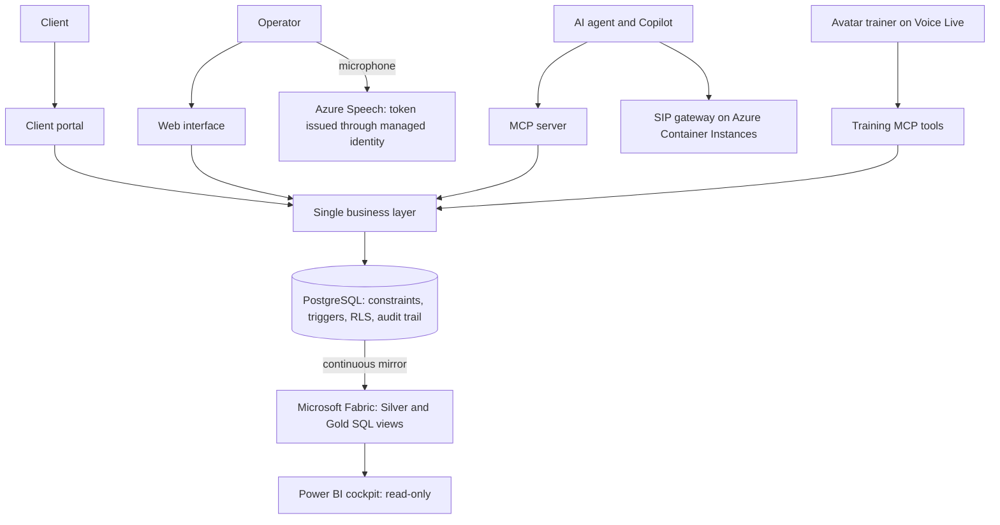

# Medispo AZ

An ERP for the distribution of sterile medical devices in Tunisia, where an AI agent works on the same business layer as the human operators, under rules it cannot bypass.

> The source code is private. This repository explains how the system is built and why.

**Scale:** 76,000+ lines of Python, 160+ MCP tools, 80 test files, 80+ ordered schema files, about 80 triggers, about 70 row-level security policies, 179 DAX measures.

## Why a dedicated ERP

Three constraints separate this business from ordinary trading: batch traceability is mandatory, the expiry date governs what leaves the warehouse, and some products cannot be sold without a regulatory authorization.

## Architecture

## Design decisions

### The database is the last line of defense

The UI and the MCP server are two clients of one business layer, and no rule lives in a screen, because an agent calling the service directly would bypass it. This goes one step further: when a rule can be a constraint, a trigger or a revoked privilege, PostgreSQL enforces it. Neither the UI, the agent, a migration script nor a manual query can get around it.

Financial documents show the approach. Once an invoice is issued, a trigger refuses any change to its totals, while the fiscal QR code stays writable. New consistency constraints are added as `NOT VALID` and validated only if existing rows comply, so a migration never breaks on history.

### Human and agent: same effect, different trace

One test is treated as the most important of the project. It runs the same goods receipt through the business layer, as the UI does, and through the MCP tools, as the agent does. It then checks that stock, batch status and movements are strictly identical, and that the audit trail records one as `human` and the other as `agent`. The agent acts under its own identity and role, never through a shared technical account.

### The agent prepares, the human confirms

Creating a product, validating an order, validating a carrier, issuing an invoice and triggering a recall all exist as tools, but the business layer refuses them to an agent. The tool returns the rule that blocks the action, so the agent can explain the refusal instead of retrying in a loop.

### One rule, one calculation

A fiscal stamp applies above a threshold, and its amount can change with each finance law. It is computed at one point per invoice type and stored, then screens, PDFs, exports, MCP tools and reports read the column. The amount is deliberately not engraved in a `CHECK`, so invoices from an earlier period stay valid. On supplier invoices, the calculated stamp is compared with the one read from the scanned document, and any gap is reported.

## Hard problems solved

### Row-level security that was not applying

Connected as the owner role with `BYPASSRLS`, the application silently bypassed the client portal's row-level security. Moving to a managed identity, as a member of an application role, is what makes the policies actually apply. The readiness probe reports the role in use and whether RLS is applied, so this cannot regress unseen. The same move removes database, storage and AI secrets from the environment.

### A real-time BI layer without a data copy

The reporting lakehouse tables had gone stale and the code that built them had been lost. They were replaced with Silver and Gold SQL views on a continuous Fabric mirror of the 60 PostgreSQL tables. Each view must expose exactly the columns of the semantic model, so the 179 DAX measures stayed unchanged. Each view documents its grain, sources and business rules. A value that cannot be calculated from the ERP is left `NULL` and reported, never invented. Views are tested locally with sqlglot and DuckDB.

### Telephony where Container Apps cannot go

SIP and RTP need UDP, which Azure Container Apps does not offer. The gateway therefore runs PJSIP on Azure Container Instances, pulls its images through a managed identity and is driven over HTTP by the ERP. It was validated with a real outbound call to a Tunisian mobile: audio in both directions, 17 to 30 ms round trip.

### Voice dictation with no key in the browser

The server obtains a short-lived Entra ID token through its managed identity and hands it to the browser, with the narrowest role possible, so it opens speech and nothing else. Dictation runs in French and Tunisian Arabic with continuous language identification. The text lands in the field, and the operator reads it and sends it: a script never does.

### Probes that tell the truth

A green `/health` with an unreachable database is a classic trap, so the two are separate: `/health` only reports that the process is alive, and `/pret` really queries the database.

### Absolute links behind an ingress

Printed documents carry QR traceability links, and those must be absolute `https` URLs even though Container Apps terminates TLS. Uvicorn runs with proxy headers, which is safe here because only the ingress can reach the container port.

## Training built into the product

The training module runs on an avatar trainer (Voice Live with its own MCP tools): lessons, steps in the real ERP and exams. Adding a module means dropping a folder of validated content files, with no code. A file that breaks the format is refused with its name and the reason, while other modules keep running.

## Stack

Python, FastAPI, PostgreSQL, MCP, Azure Container Apps, Azure Container Instances, Azure AI Foundry, Azure AI Speech, Azure Voice Live, Document Intelligence, Microsoft Fabric, Power BI, PJSIP, Key Vault, managed identity, Azure DevOps
