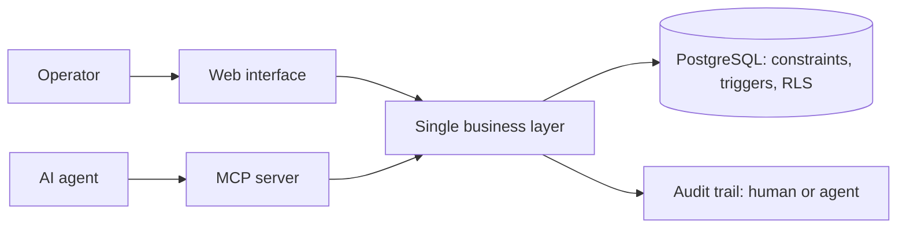

# Medispo AZ

ERP for the distribution of sterile medical devices in Tunisia, with an AI agent working on the same business layer as the UI.

> The source code is private. This repository documents the product and its architecture.

## At a glance

- 76,000+ lines of Python
- 160+ MCP tools
- 80 test files

## Why a dedicated ERP

Three constraints separate this business from ordinary trading: batch traceability is mandatory, the expiry date governs what leaves the warehouse, and some products cannot be sold without a regulatory authorization.

## Architecture

## Engineering decisions

- **The UI and the MCP server are two clients of one business layer.** No business rule lives in the screen, because an agent calling the service directly would bypass it.
- **Hard rules live in the database.** When a rule can be written as a constraint, a trigger or a revoked privilege, PostgreSQL enforces it. Neither the UI, the agent nor a migration script can get around it.
- **Tested parity.** A test runs the same goods receipt through the UI path and through the MCP tools, then checks that the results are identical and that the audit trail tells them apart.
- **The agent prepares, the human confirms.** Sensitive actions such as issuing an invoice are refused to an agent, and the tool returns the rule that blocks it so the agent can explain why instead of retrying.
- **Managed identity instead of secrets** for outbound access to the database, storage and AI services.
- **Liveness and readiness are separate.** One probe says the process is alive, the other actually queries the database.

## What it does

- Copilot for operators and a client portal
- Voice dictation in French and Tunisian Arabic
- SIP telephony
- Power BI and Fabric cockpit
- Avatar-led training

## Stack

Python, FastAPI, PostgreSQL, Azure Container Apps, Azure AI Foundry, Azure Speech, Power BI, Microsoft Fabric, Azure DevOps
